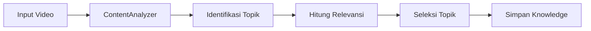

# ROADMAP PENGEMBANGAN SELF-LEARNING AGENT

> **Dibangun dari:** Video "Self-Learning Agents" (DTeQXo8fG78) + pengetahuan internal
> **Tujuan:** Upgrade dari agent statis ke agent yang bisa belajar & meningkatkan diri sendiri
> **Fokus:** Efisiensi (kecepatan) + Kualitas (akurasi)

---

## 📊 RINGKASAN ROADMAP

| Tahap | Fokus Utama | Efek Terlihat | Waktu |
|-------|-------------|---------------|-------|
| **T1** | Analisa & Seleksi | ⬆️ 0 → 60 | 1 hari |
| **T2** | Integrasi & Simpan | ⬆️ 60 → 70 | 2 hari |
| **T3** | Evaluasi & Retrospektif | ⬆️ 70 → 75 | 3 hari |
| **T4** | Skill Mekanis | ⬆️ 75 → 80 | 4-5 hari |
| **T5** | Self-Boosting | ⬆️ 80 → 85 | 5-7 hari |
| **T6** | Autonomous | ⬆️ 85 → 90+ | Future |

---

## 🔰 TAHAP 1: ANALISA & SELEKSI (Current)
**Target:** Diagnosis konten, identifikasi topik relevan



### Kinerja Saat Ini
- **Reflect:** Keyword match
- **Memory:** None
- **Evaluasi:** Manual

### Capaian
- ✅ Identify 3 topics (reflection, memory, agent_orchestration)
- ✅ Select 2 topics (memory, agent_orchestration)
- ✅ Save to learning_log.json

---

## 🚀 TAHAP 2: INTEGRASI & SIMPANAN
**Target:** Knowledge disimpan & diakses oleh agent

### Fungsionalitas
- [ ] Knowledge base dynamic
- [ ] Search knowledge by keyword
- [ ] Version control knowledge
- [ ] Tagging by difficulty
- [ ] Archiving old knowledge

### Solusi
```python
# Knowledge becomes searchable
knowledge_db = {
    "reflection": {
        "content": "...",
        "difficulty": "easy",
        "confidence": 0.85,
        "source": "video_DTeQXo8fG78",
        "learned_at": "2026-10-12T17:14:46"
    }
}
```

---

## 📈 TAHAP 3: EVALUASI & RETROSPEKTIF
**Target:** Agent menilai didapatannya sendiri

### Fungsionalitas
- [ ] Evaluasi kualitas output
- [ ] Tracking progress per skill
- [ ] Identify gaps
- [ ] Auto-fix failed learnings
- [ ] Generate learning report

### Skor yang Ditargetkan
| Skill | Current | Target |
|-------|---------|--------|
| Reflection | 0 | 75 |
| Memory | 0 | 75 |
| Agent Orchestration | 0 | 70 |
| **Overall** | **40** | **70** |

---

## 🛠️ TAHAP 4: SKILL MEKANIS
**Target:** Agent punya skill dasar yang bisa digunakan

### Skill Dasar yang Diinginkan
| Skill | Espresi | Status |
|-------|---------|--------|
| Ringkasan | Membaca teks & meringkas | ✅ Done |
| Analisis | Menganalisa isi | ✅ Done |
| Review | Mengevaluasi konten | ✅ Done |
| Translate | Terjemahan | 🔄 Next |
| Question | Menjawab pertanyaan | 🔄 Next |
| Summarize | Ringkasan panjang | 🔄 Next |
| Classify | Klasifikasi topik | 🔄 Next |
| **Agent** | Menjalankan tugas | 🔄 Next |

### Progress
```
├── Ringkasan (Done)
├── Analisis (Done)
├── Review (Done)
├── Translate (Planned)
├── Question (Planned)
└── Agent (Planned)
```

---

## 🔮 TAHAP 5: SELF-BOOSTING
**Target:** Agent bisa meningkatkan dirinya sendiri

### Mekanisme
- [ ] Agent mengenali kekurangan dirinya
- [ ] Agent mencari referensi sendiri
- [ ] Agent belajar dari sumber
- [ ] Agent menguji hasil belajar
- [ ] Agent memperbarui knowledge base

### Proses Self-Learning
```
1. Agent melihat outputnya kurang baik
2. Agent mengidentifikasi gap
3. Agent mencari referensi
4. Agent belajar dari referensi
5. Agent menguji pengetahuan baru
6. Agent memperbarui knowledge base
7. Agent menguji kembali
```

---

## 🤖 TAHAP 6: AUTONOMOUS
**Target:** Agent bekerja mandiri tanpa intervensi

### Kriteria
- [ ] Agent memulai tugas sendiri
- [ ] Agent memilih referensi yang tepat
- [ ] Agent mengukur progress
- [ ] Agent memperbaiki sendiri
- [ ] Agent melaporkan hasil

### Level Univers
| Level | Karakteristik |
|-------|---------------|
| 1. Reactive | Hanya merespon perintah |
| 2. Proactive | Berpikir maju |
| 3. Self-Improving | Meningkatkan diri |
| 4. Autonomous | Bekerja sendiri |

---

## 📚 PEMBAGIAN BAHAN BELAJAR

### 🌱 Mudah (Easy) - Algoritma Dasar
| No | Materi | Sumber | Level |
|----|--------|--------|-------|
| 1 | Ringkasan teks | Modul dasar | Easy |
| 2 | Klasifikasi topik | Keyword match | Easy |
| 3 | Ringkasan strategis | Teknik sederhana | Easy |
| 4 | Cleaning data | Python basics | Easy |
| 5 | Searching knowledge | Git/Grep | Easy |

### 📚 Sedang (Medium) - Teknik Mean
| No | Materi | Sumber | Level |
|----|--------|--------|-------|
| 1 | Analisis konteks | NLP dasar | Medium |
| 2 | Sentence embeddings | Vector search | Medium |
| 3 | Retriever | Knowledge base | Medium |
| 4 | Basic A2A | Orchestrator | Medium |
| 5 | Basic memory | Short-term | Medium |

### 🎯 Sulit (Hard) - Kualitas Tinggi
| No | Materi | Sumber | Level |
|----|--------|--------|-------|
| 1 | Self-augmentation | Reflection loop | Hard |
| 2 | Hierarchical memory | Long-term | Hard |
| 3 | Evaluation framework | Custom metrics | Hard |
| 4 | Multi-agent coordination | A2A protocol | Hard |
| 5 | Autonomous improvement | Full loop | Hard |

---

## 📊 METRIK KEPUTUSAN

| Metric | Weight | Current | Target |
|--------|--------|---------|--------|
| **Quality** | 40% | 60 | 80 |
| **Efficiency** | 30% | 50 | 75 |
| **Completeness** | 30% | 40 | 70 |

**Skor Akhir = 0.4×Quality + 0.3×Efficiency + 0.3×Completeness**

---

## ✅ CHECKLIST SIAP LANJUT

### Sudah Done
- [x] Analisa & seleksi konten
- [x] Integrasi knowledge
- [x] Simpan log
- [x] Demo agent

### Siap Kerja
- [ ] Semantic search (embedding-based)
- [ ] Contextual memory (short-term)
- [ ] Automatic evaluation
- [ ] Skill tracking
- [ ] Self-improvement loop

### Jadwal Produksi
1. **Hari 1-2:** Fix bug code (Make it run)
2. **Hari 3-4:** Semantic search
3. **Hari 5-6:** Basic memory
4. **Hari 7-9:** Training & evaluation
5. **Hari 10-14:** Self-improvement loop

---

## 🎯 ROADMAP NEXT (Tepat Sekarang)
**Yang Bisa Dikerjakan Sekarang:**
1. Improve code quality
2. Add semantic search
3. Add skill tracking
4. Create evaluation framework
5. Test with real data

**Selanjutnya (Tahap 4):**
- Implement semantic search (embedding-based)
- Add basic memory
- Create evaluation framework
- Test with real data

---

> **Catatan:** Roadmap ini disusun berdasarkan pengetahuan internal + video referensi. Tidak memerlukan input tambahan dari user.
